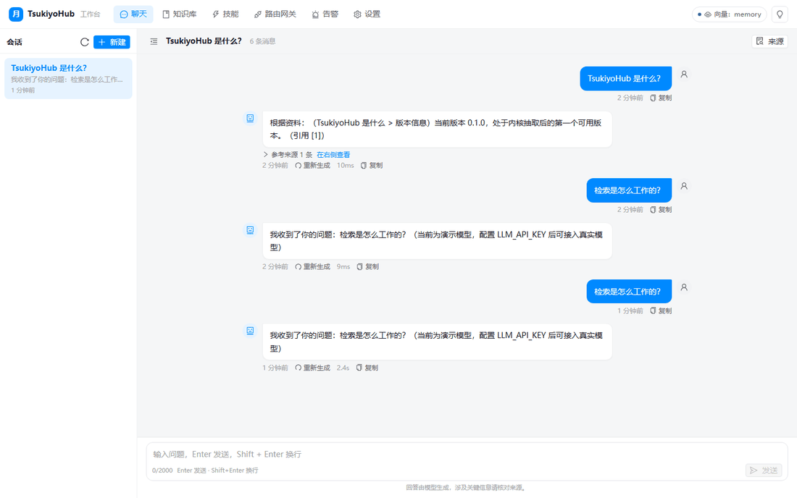
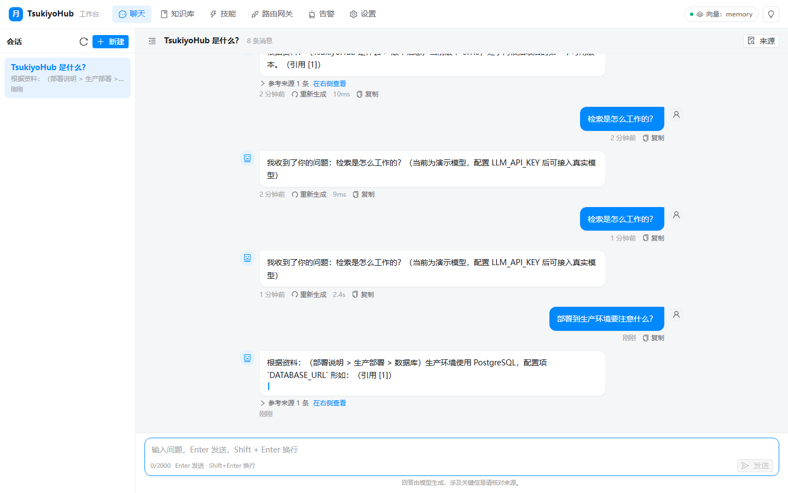
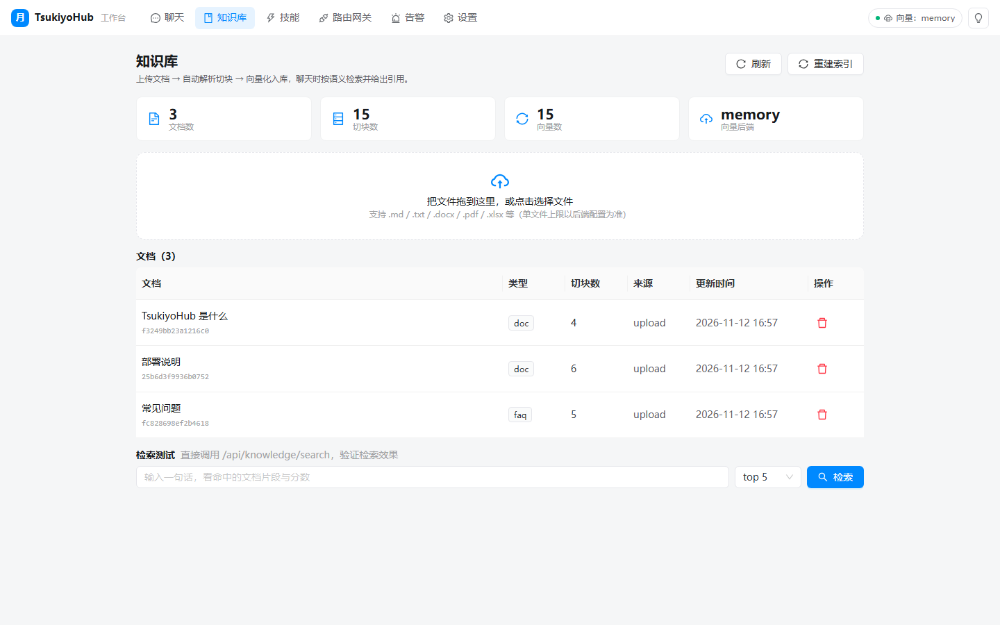
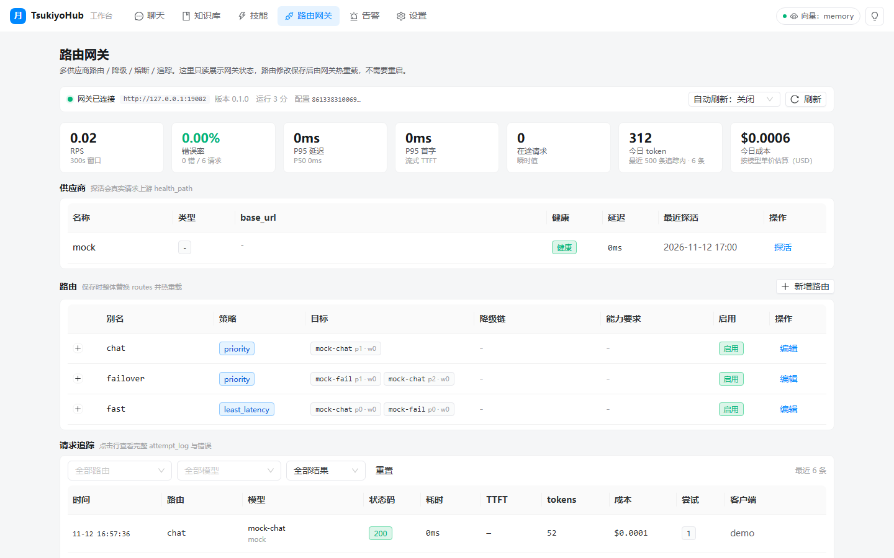
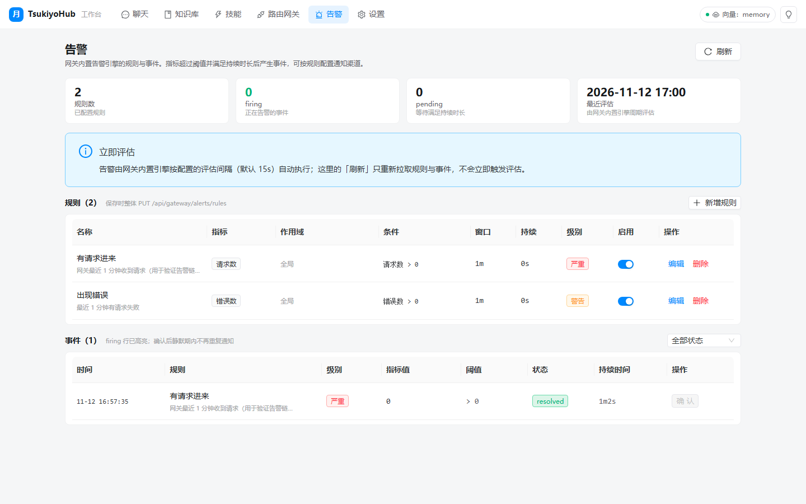

<div align="center">

# 🌙 TsukiyoHub

[中文](README.md) · [English](README.en.md)

**与业务无关的「聊天 + 技能 + RAG」内核服务 —— 任何前端都能接**

从 `HQDingTalkrobot`（Python 后端）与 `HQDingtalkRobotUI`（Vue 3 前端）中抽取出来的通用内核：
去掉了钉钉、组织架构、办公流程等企业业务，只保留「一次对话怎么走通、知识怎么被检索、能力怎么被调用」。

`FastAPI` · `OpenAI 兼容` · `SSE 流式` · `混合检索 (向量 + BM25 + RRF)` · `防幻觉三道关` · `Skills / MCP` · `Vue 3 工作台`

[](https://github.com/shilaoban666/TsukiyoHub/actions/workflows/ci.yml)
[](pyproject.toml)
[](gateway/go.mod)
[](web/package.json)
[](LICENSE)
[](docs/observability.md)
[](gateway/deploy/grafana/dashboard.json)
[](https://github.com/shilaoban666/TsukiyoHub/stargazers)
[](https://github.com/shilaoban666/TsukiyoHub/issues)



</div>

---

## 这是什么

TsukiyoHub 是一个**可以独立部署、被任意前端接入**的 AI 服务内核：

```
你的前端 (Web / 桌面 / IDE / 小程序 / IM / Dify / FastGPT / 任何 App)
        │  HTTP + SSE + OpenAI 兼容协议
        ▼
┌──────────────────────────────────────────────────────────────┐
│                       TsukiyoHub 服务                         │
│                                                              │
│  聊天内核            技能内核               RAG 内核            │
│  · 会话与多轮上下文   · 工具协议 / 注册表    · 解析 · 切块        │
│  · 模型工具循环       · SKILL.md 技能       · 向量化 + 缓存      │
│  · 流式逐字输出       · MCP (stdio/sse)    · 混合检索 + RRF      │
│  · 主备模型降级       · 内置知识/网页/计算   · 证据闸门 + 逐句核对  │
│  · 引用编号与来源     · 启用开关            · 引用与来源         │
│                                                              │
│  端口层：LLM / Embedding / VectorStore / Blob / SessionStore   │
└──────────────────────────────────────────────────────────────┘
        │
        ├─ SQLite（默认，开箱即用） / PostgreSQL
        ├─ 内存混合检索（默认，零依赖） / Milvus
        └─ 本地文件存储 / OSS
```

**它不关心你的用户是谁、你的业务是什么。** 你只要给它文档，它就会基于文档回答，并告诉你答案出自哪一段；
你只要注册技能，模型就能调用它们；你的前端只要会发 HTTP，就能拿到逐字输出。

---

## 60 秒跑起来（零外部依赖）

```powershell
# 1. 准备环境（Python 3.11+）
cd E:\Project\TsukiyoHub
python -m venv .venv
.venv\Scripts\python -m pip install -e ".[dev]"

# 2. 复制配置（不填密钥也能跑：默认用演示模型 + 关键词检索）
Copy-Item .env.example .env

# 3. 放几篇文档进知识库（仓库自带示例）
New-Item -ItemType Directory -Force data\knowledge | Out-Null
Copy-Item examples\knowledge\*.md data\knowledge\

# 4. 启动（默认 fake 模型 + 关键词检索，零外部依赖）
.venv\Scripts\python -m tsukiyohub
```

打开 <http://127.0.0.1:8080/docs> 就是交互式 API 文档，直接点 `POST /api/chat` 试一句。

```bash
curl -X POST http://127.0.0.1:8080/api/chat \
  -H "Content-Type: application/json" \
  -d '{"question": "TsukiyoHub 支持哪些检索方式？", "user_id": "demo"}'
```

> 只做关键词检索也能回答（`ANSWER_JUDGE=strict` 时逐句核对会检查回答是否被资料支持）。
> 想接真实模型：在 `.env` 里填 `LLM_API_KEY` / `LLM_MODEL` / `LLM_BASE_URL`，重启即可。

### 启动前端工作台

```powershell
cd web
npm install
npm run dev          # http://127.0.0.1:5173 ，已代理 /api → :8080
```

---

## 三条内核，各自解决什么问题

### 💬 聊天内核（`server/tsukiyohub/kernel/chat/`）

一次问答的完整链路：

```
用户问题
  → 会话解析（新建 / 续聊）+ 历史拼接（超长自动摘要）
  → 记忆召回（这个用户以前让我记住的事）
  → 系统提示词（人设 + 风格 + 技能规则 + 本轮情景）
  → 模型工具循环（最多 N 轮）
       ├─ 直接回答（闲聊 / 通用问题）
       ├─ 调用 knowledge_search → 证据回填 → 再生成，正文标 [n]
       └─ 调用其它技能（网页抓取 / 计算 / SKILL.md / MCP）
  → 回答核对（逐句判断资料是否支持，strict 模式删掉无依据句）
  → 引用整理（段编号 → 文档编号，生成「参考来源」）
  → 落库 + 返回（含 citations / grounded / usage / 耗时）
```

- **流式**：`delta` 推的是「当前累积全文」，前端整段替换即可，天然幂等，丢帧也不会错位；
- **降级**：主模型失败 → 备用模型 → 直接给资料原文摘录（`degraded=true`），不会给用户报错；
- **模型不支持工具调用**：自动退回「先检索、再作答」的简单链路。

### 🧰 技能内核（`server/tsukiyohub/kernel/skills/`）

一个能力单元只要实现 `BaseSkill`（名字 / 描述 / JSON Schema / `call()`）就能被模型调用：

```python
class WeatherSkill(BaseSkill):
    name = "get_weather"
    title = "查天气"
    description = "查询某个城市今天的天气"
    parameters = {"type": "object", "properties": {"city": {"type": "string"}}, "required": ["city"]}

    def call(self, args, ctx):
        return f"{args['city']} 今天晴，26℃"
```

三类技能统一注册、统一启停、统一从 `GET /api/skills` 暴露：

| 类型 | 来源 | 说明 |
|---|---|---|
| `tool` | 代码里注册的 `BaseSkill` | 内置：`knowledge_search` / `web_fetch` / `web_search` / `calculator` |
| `skill` | `data/skills/<name>/SKILL.md` | 纯提示词技能：front matter 写描述，正文是操作说明，模型按需 `use_skill` 加载 |
| `mcp` | `MCP_CONFIG_FILE` 指向的 JSON | 外部 MCP server 的工具，自动包装成技能 |

### 📚 RAG 内核（`server/tsukiyohub/kernel/rag/`）

```
上传 / 导入
  → 解析（md / txt / pdf / docx / xlsx / pptx / csv / json）
  → 切块（按段落与句子边界，默认 700 / 120）
  → 向量化（带缓存，失败可重试）
  → 写索引（Milvus 或内存）
  → 检索：向量召回 + BM25 召回 → 加权 RRF 融合 → 可选重排
  → 证据闸门：最高向量分不够 / 词面不重叠 → 判定「知识库里没有」
  → 生成后逐句核对：资料不支持的句子删掉（strict）
```

检索参数全部可配（`RETRIEVAL_*`），并且 `POST /api/knowledge/search` 会把每条命中的
`vector_score / bm25_score / score / reranker_score` 都返回，方便你调阈值。

---

### 🚦 路由网关 + 告警（`gateway/`，Go）

放在所有 LLM 上游前面的一层 OpenAI 兼容网关（零第三方依赖，单二进制）：

- **可插拔选路**：`priority` 主备降级 / `weighted` 加权 / `round_robin` / `least_latency` /
  `cost` / `canary` 灰度 / `sticky` 会话粘性 / `capability` 能力匹配 —— 加策略只加一个文件；
- **可靠性与成本**：多上游自动降级、熔断（连续失败/错误率）、超时、RPM/TPM 限流、月预算、成本核算；
- **可观测**：Prometheus `/metrics`（请求/延迟/TTFT/token/成本/熔断/供应商健康）+ 请求追踪；
- **告警**：内置规则引擎（pending→firing→resolved、冷却、Ack 静默）+ 通知渠道
  （log / webhook / 钉钉 / Slack），同时提供 `deploy/prometheus` + `deploy/alertmanager` 外部告警配置；
- **零改代码接入新供应商**：`config.json` 加 provider + model + 挂到 route 即可，热更新不重启。

```
你的前端 / TsukiyoHub  ──OpenAI 兼容──▶  tsukiyo-gateway  ──▶  OpenAI / DeepSeek / Qwen / Ollama / vLLM / 中转站
                                          │
                                          ├─ /metrics（Prometheus）
                                          └─ /admin/api/*（TsukiyoHub 的「路由网关」「告警」页面代理）
```

详见 [`docs/gateway.md`](docs/gateway.md)。

### 📈 可观测性（Prometheus + Grafana）

两个服务都暴露标准 `/metrics`（手写 exposition，零第三方依赖），并提供完整的**接入参考表**：

- **网关**：请求数 / P95 / **TTFT** / tokens / 成本 / 熔断状态 / 供应商健康 / 限流与预算拒绝
- **内核**：HTTP / 问答（意图、grounded、降级）/ **SSE 首字** / 检索耗时与命中 / **技能调用** /
  引用数 / 知识库规模 / 会话与记忆
- **记录规则**：`tokens/s`、`TPOT`、P95/P99、`cost per 1M output tokens`、`grounded_ratio`、SLO 燃烧率
- **告警**：网关 7 条 + 内核 6 条（含 agent 工具失败率、有据回答占比）+ SLO 多窗口燃烧率
- **看板**：`gateway/deploy/grafana/dashboard.json`（一键导入）

```powershell
docker compose --profile monitor up -d   # Prometheus 9090 / Alertmanager 9093 / Grafana 3000
```

指标口径、PromQL 示例、排障速查表、业界约定对照（OTel GenAI / vLLM）见
[`docs/observability.md`](docs/observability.md)。

---

## 界面速览

| 聊天（流式 + 引用） | 知识库 |
|---|---|
|  |  |

| 路由网关（Prometheus 指标 / 熔断 / 追踪） | 告警（规则 / 事件 / Ack） |
|---|---|
|  |  |

> 以上截图与顶部 GIF 都由脚本自动录制：见 [`docs/demo.md`](docs/demo.md)（`scripts/demo/`）。

---

## 任何前端怎么接

### 1. 最省事：OpenAI 兼容协议

任何支持自定义 OpenAI 端点的产品（Dify、FastGPT、Cherry Studio、IDE 插件、Agent 平台）都能直接接：

```
Base URL: http://127.0.0.1:8080/api/v1
API Key : （.env 里 API_KEY 留空则随便填）
Model   : 任意（服务端用自己的模型配置）
```

### 2. 标准 REST + SSE

```javascript
// 非流式
const res = await fetch("http://127.0.0.1:8080/api/chat", {
  method: "POST",
  headers: { "Content-Type": "application/json" },
  body: JSON.stringify({ question: "怎么配置 Milvus？", user_id: "u-1" }),
});
const data = await res.json();   // { answer, citations, grounded, usage, ... }

// 流式（POST + fetch + ReadableStream，EventSource 不支持 POST body）
const res = await fetch("http://127.0.0.1:8080/api/chat/stream", { method: "POST", ... });
const reader = res.body.getReader();
// 事件：status / progress / tool / delta(累积全文) / reset / meta / error / done
```

完整事件表与 TypeScript 类型见 [`docs/api.md`](docs/api.md)。

### 3. 直接拿参考前端改

`web/` 是一个完整可用的聊天工作台（会话列表 / 流式消息 / 引用面板 / 知识库管理 / 技能开关 / 设置），
用 Vue 3 + TypeScript 写，改配色和图标就能变成你自己的产品界面。

---

## 目录结构

```
TsukiyoHub
├─ server/tsukiyohub/
│  ├─ config.py            全部配置项（pydantic-settings，一处读取）
│  ├─ domain.py            数据契约：消息 / 文档 / 切块 / 引用 / 会话 / 技能
│  ├─ ports/               端口协议：LLM / Embedding / VectorStore / Blob / Store
│  ├─ adapters/            端口实现：OpenAI 模型 / 向量化 / Milvus / 内存检索 / SQLite·PG
│  ├─ kernel/
│  │  ├─ chat/             会话编排、模型循环、提示词、引用整理、流式事件
│  │  ├─ skills/           技能协议、注册表、SKILL.md 发现、MCP、内置技能
│  │  ├─ rag/              解析、切块、检索、融合、证据闸门、逐句核对
│  │  └─ memory/           长期事实记忆、长对话摘要
│  ├─ api/                 路由：chat / sessions / skills / knowledge / memory / system
│  ├─ container.py         依赖装配（换实现只改这里）
│  └─ app.py               应用装配与生命周期
├─ web/                    Vue 3 聊天工作台（参考前端，可整体替换）
├─ examples/knowledge/     示例文档（拷进 data/knowledge 即可体验）
├─ tests/                  pytest
└─ docs/                   架构 / API / 各内核说明 / 抽取对照
```

---

## 常用配置

| 变量 | 默认 | 说明 |
|---|---|---|
| `LLM_PROVIDER` / `LLM_MODEL` / `LLM_BASE_URL` / `LLM_API_KEY` | openai / gpt-4o-mini / 官方 / 空 | 对话模型（OpenAI 兼容，任何供应商） |
| `LLM_FALLBACK_MODEL` | 空 | 主模型失败时自动切换 |
| `EMBEDDING_PROVIDER` | openai | `openai` / `dashscope` / `hash`（hash = 零依赖演示：没有语义向量，检索退化为关键词 BM25） |
| `VECTOR_BACKEND` | memory | `memory`（零依赖）/ `milvus`（生产） |
| `DATABASE_URL` | 空 = SQLite | 生产填 `postgresql+psycopg://...` |
| `GROUNDING_MIN_SCORE` | 0.35 | 「知识库里没有」的判定阈值，**换 embedding 模型后要重标定** |
| `ANSWER_JUDGE` | strict | 逐句核对：strict / lenient / off |
| `MAX_TOOL_ROUNDS` | 3 | 一条消息里最多几轮工具调用 |
| `SKILLS_ENABLED` | knowledge_search,web_fetch | 默认启用的内置技能 |
| `MCP_CONFIG_FILE` | 空 | MCP server 配置 JSON 路径 |
| `API_KEY` | 空 | 留空 = 不鉴权；填了要求 Bearer |

全部配置见 [`.env.example`](.env.example)。

---

## 从原项目抽取了什么、丢了什么

| 原项目能力 | 在 TsukiyoHub 的去向 |
|---|---|
| Agent 工具循环、流式输出、主备模型降级、回答核对 | → `kernel/chat/`（去业务化重写） |
| Agentic 图（感知 → 计划 → 检索 → 生成 → 核对） | → `kernel/chat/agentic.py`（纯 Python 轻量版，不依赖 LangGraph） |
| 引用编号、来源列表、证据闸门、逐句核对 | → `kernel/chat/citations.py` + `kernel/rag/` |
| 混合检索（向量 + BM25 + RRF + 重排）、切块、解析 | → `kernel/rag/`（Milvus 与内存双实现） |
| 工具注册表、SKILL.md 技能发现、MCP | → `kernel/skills/`（补齐了启停、REST、use_skill、MCP 包装） |
| 长期记忆（热/温/冷、抽取、召回、禁记） | → `kernel/memory/` + `adapters/store_sql.py`（精简为事实记忆 + 摘要） |
| 钉钉 Stream 长连接、AI 卡片、通讯录、办公打卡、发文件、部门洞察、管理后台、知识盘同步 | ✂️ **丢弃**：这些属于具体业务，不属于内核 |
| Vue 3 管理后台（知识库/机器人/分析/组织…） | → `web/` 只保留「聊天工作台 + 知识库 + 技能 + 设置」 |
| 登录鉴权（钉钉扫码 / 密码 / 权限路由） | ✂️ 丢弃；内核只提供可选 `API_KEY` |

抽取的详细对照见 [`docs/extraction.md`](docs/extraction.md)。

---

## 开发与验证

```powershell
# 后端测试（278 个用例，零外部依赖）
$env:PYTHONPATH="E:\Project\TsukiyoHub\server"
python -m pytest tests -q

# 前端构建
cd web; npm run build

# 冒烟：先启动服务，再跑（会真的上传示例文档、走一次问答与流式）
python scripts\smoke.py --base http://127.0.0.1:8080

# 一键自检（编译 + 单测 + 可选启动冒烟）
.\scripts\check.ps1 -Smoke

# 路由网关：编译 + vet + 单测（-Smoke 会起假上游跑端到端：路由/降级/熔断/限流/告警/热更新）
.\scripts\gateway_check.ps1 -Smoke
```

---

## 文档索引

| 文档 | 内容 |
|---|---|
| [`docs/architecture.md`](docs/architecture.md) | 分层、时序、降级矩阵、数据流 |
| [`docs/api.md`](docs/api.md) | 全部接口、SSE 事件、TypeScript 类型 |
| [`docs/chat.md`](docs/chat.md) | 聊天内核：链路、提示词、事件流、降级、换模型、加技能 |
| [`docs/rag.md`](docs/rag.md) | 检索内核：入库、切块、融合、阈值标定、换后端 |
| [`docs/skills.md`](docs/skills.md) | 技能系统：Tool/SKILL.md/MCP、如何写一个技能 |
| [`docs/memory.md`](docs/memory.md) | 记忆：抽取、召回、禁记、清空 |
| [`docs/gateway.md`](docs/gateway.md) | 路由网关与告警：配置、策略、指标、扩展点 |
| [`docs/observability.md`](docs/observability.md) | **Prometheus 接入参考表**：指标清单 / PromQL / 告警 / 看板 / 面试讲法 |
| [`gateway/docs/alerts.md`](gateway/docs/alerts.md) | 告警规则/渠道与 Prometheus、Alertmanager 部署 |
| [`docs/web.md`](docs/web.md) | 参考前端：结构、SSE 解析、主题、对接自己的后端 |
| [`docs/web-gateway.md`](docs/web-gateway.md) | 前端「路由网关 / 告警」页面说明与接口对应 |
| [`docs/demo.md`](docs/demo.md) | 演示 GIF/截图怎么录（脚本化、可重录） |
| [`docs/publishing.md`](docs/publishing.md) | GitHub 发布清单：badge、About/topics、tag/release、拆子仓 |
| [`CHANGELOG.md`](CHANGELOG.md) · [`SECURITY.md`](SECURITY.md) · [`CONTRIBUTING`](.github/PULL_REQUEST_TEMPLATE.md) | 版本记录 / 安全策略 / 贡献流程 |
| [`docs/extraction.md`](docs/extraction.md) | 从原项目抽取的逐文件对照与踩坑记录 |
| [`docs/design/`](docs/design/) | 抽取期的侦察与契约文档（历史资料） |

---

## 设计取舍（为什么不是简单复制）

1. **内核只依赖端口，不依赖框架**：LangChain 只出现在 `adapters/llm_openai.py` 里，
   换掉它不影响 chat/rag/skills；换向量库只改 `container._build_vector_store`。
2. **零依赖可跑**：内存检索 + SQLite + 演示模型，让「接上前端看一眼」的成本降到最低；
   生产再把 `VECTOR_BACKEND=milvus`、`DATABASE_URL=postgresql://...` 打开。
3. **防幻觉优先于答得多**：证据闸门 + 逐句核对默认开启，宁可说「不知道」也不编。
4. **前端只是消费者**：SSE 事件与 REST 契约都在 `domain.py` / `docs/api.md` 里，
   换任何前端都不需要动后端。

---

<div align="center">

MIT License · 用任意前端，接同一个内核 🌙

</div>