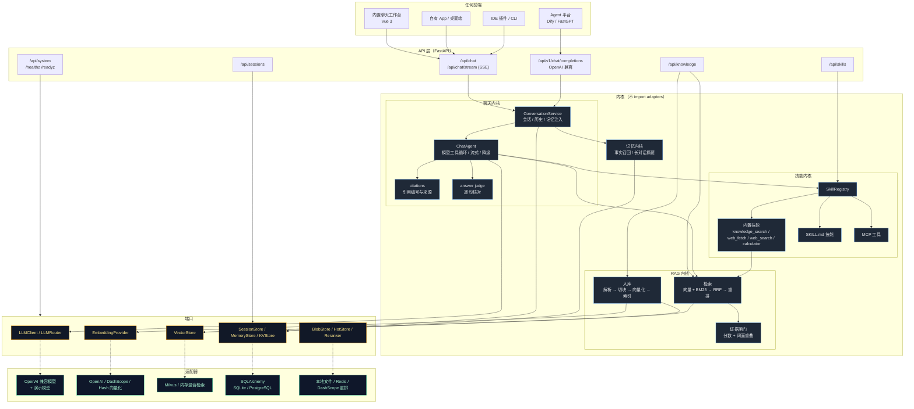
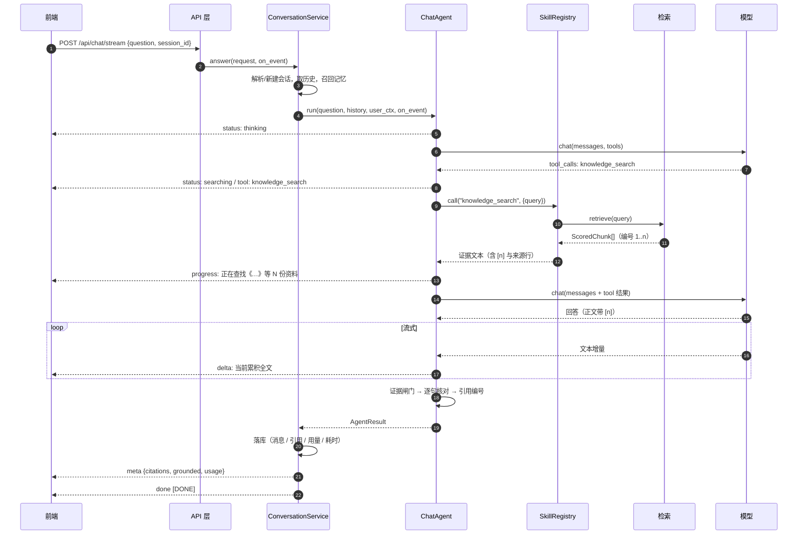

# 架构

TsukiyoHub 的架构只有一句话：**内核只依赖端口，任何实现都能替换，任何前端都能接入。**



## 一次问答的时序



## 为什么这样分层

| 层 | 依赖谁 | 被谁依赖 | 换掉它的代价 |
|---|---|---|---|
| `domain.py` | pydantic | 所有层 | 高（改契约） |
| `ports/` | domain | 内核 + adapters | 高（改实现） |
| `kernel/` | domain + ports | api + container | 中 |
| `adapters/` | domain + ports + 第三方 SDK | container | 低（只改 container 一行） |
| `api/` | domain + container | 前端 | 低（前端契约不变即可） |
| `web/` | HTTP 契约 | — | 极低（可整体替换） |

关键约束：**内核不 import adapters**。这条约束保证「换模型 / 换向量库」不会牵动业务逻辑；
LangChain 只出现在 `adapters/llm_openai.py`，pymilvus 只出现在 `adapters/vector_milvus.py`。

## 降级矩阵

系统在任何依赖故障时都尽量给出「可用的回答」，而不是报错：

| 故障 | 行为 |
|---|---|
| 没配 `LLM_API_KEY` | 使用演示模型（`FakeLLMClient`），仍能演示工具调用与流式 |
| 主模型调用失败 | 自动切备用模型；都失败 → 直接给资料原文摘录（`degraded=true`） |
| 模型不支持工具调用 | 自动退回「先检索、再作答」（`mode=plain`） |
| 向量化失败 | 该文档入库失败并返回原因（可重试）；检索退化为纯 BM25 |
| Milvus 连不上 | 自动退回内存检索后端（重启后需重建索引） |
| Redis 不可用 | 直接读数据库 |
| 知识库无命中 | 证据闸门判定「不知道」，不编造（`grounded=false`） |
| 逐句核对超时 | 保留原答案，记 warning（`answer_judge=lenient` 时只告警） |

## 数据流：文档怎么变成可检索的证据

```
文件（md/txt/pdf/docx/xlsx/pptx/csv/json）
  │ DocumentParser：按扩展名分派，编码探测，失败给可读错误
  ▼
Document（meta + 纯文本 + content_hash）
  │ TextChunker：按段落/句子边界切，700 字 / 120 重叠，chunk_id = doc_id#ordinal
  ▼
Chunk[]
  │ CachedEmbeddings：批量向量化（带缓存，失败重试）
  ▼
IndexRow（chunk + vector）
  │ VectorStore.upsert：先写新切块，再删旧切块（无检索空窗）
  ▼
可检索；清单落盘在 data/index/kb_index_docs.json + kb_index_chunks.jsonl
```

## 目录与责任

| 目录 | 责任 | 不该出现的东西 |
|---|---|---|
| `kernel/chat` | 对话编排、提示词、引用 | HTTP、数据库、具体供应商 SDK |
| `kernel/skills` | 技能协议、注册、发现、MCP | 具体业务动作（请假、报销…） |
| `kernel/rag` | 解析、切块、检索、核对 | 上传接口、前端字段 |
| `kernel/memory` | 事实记忆、摘要 | 组织架构、员工画像 |
| `adapters` | 第三方实现 | 业务判断 |
| `api` | 协议转换、鉴权、限流 | 复杂业务逻辑（应放内核） |
| `web` | UI | 直接拼后端 URL（统一走 `src/api/*`） |